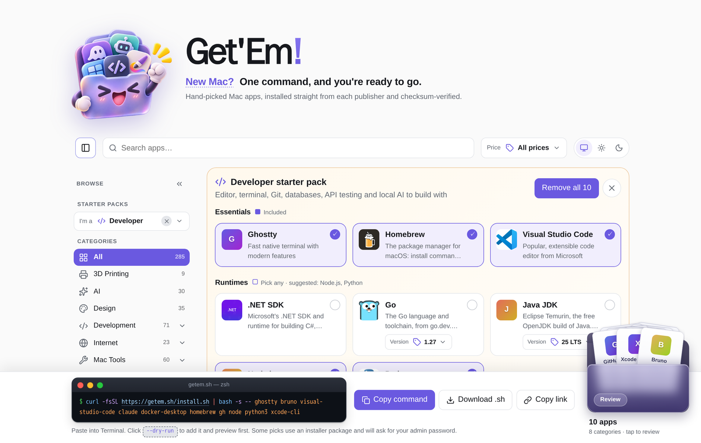

<p align="center">
  
</p>

<h1 align="center">Get'Em!</h1>

<p align="center"><strong>New Mac? One command, and you're ready to go.</strong><br>
Hand-picked Mac apps, installed straight from each publisher and checksum-verified.</p>



Pick apps (or a starter pack for your role) on a web page and get one Terminal command that installs them all:

```sh
curl -fsSL https://your-site/install.sh | bash -s -- iina rectangle stats
```

- **The list is ours.** `data/apps.json` holds the core picks, `data/extras.json` the apps added later and `data/builtins.json` the ones installed through Apple or npm. Nothing is pulled in automatically, so an app is listed only if we chose it.
- **Starter packs:** `data/profiles.json` defines the role packs (Developer, Designer ...). A pack is either a plain list or parts to choose from: pick one (an editor, a browser), pick any (runtimes, chat apps) or included. `data/families.json` groups apps from one publisher.
- **Versions:** Java, Node.js, Python and Go are one card each with a version dropdown.
- **Versions, download URLs and SHA-256 checksums:** from the [Homebrew Cask API](https://formulae.brew.sh/api/cask.json) or, for apps outside Homebrew, the publisher's GitHub release page or a fixed download link. Homebrew itself is not needed on the user's Mac.
- **Installer:** downloads from each publisher, verifies the checksum, and handles dmg, zip, tar and pkg files. It picks the Apple Silicon or Intel build and skips apps that are already up to date. Add `--dry-run` to preview, `--force` to reinstall or `--update` to refresh everything installed from the list.
- **Share and download:** a short link restores the same selection, and **Download .sh** produces a script with the chosen apps built in.

## Develop

```sh
npm run build   # refresh versions and checksums → public/catalog.json, catalog.tsv, install.sh
npm run media   # find icons and screenshots for new apps (add -- --deep for a harder pass)
npm run dev     # http://localhost:3000
npm test        # catalog checks, the installer in --dry-run, and the page itself in jsdom
```

The tests run on every push (`.github/workflows/test.yml`) and before each deploy. The page tests use real apps
and packs from the catalog (Developer, Muggle, VLC ...), so when you curate those, a test may need the new name.

Curating: see `data/README.md` for what each file does. In short: delete an entry from `data/apps.json` to
drop an app (or from `data/extras.json` for later additions), change its `category` there to move it, and use
`data/media-overrides.json` to set its icon or screenshots by hand. Apps that can't be installed automatically
are listed in `data/skipped.txt`, with the reason.

## Deploy

It's a static site, published with GitHub Pages by `.github/workflows/pages.yml`. The workflow runs
`npm run build` and publishes the `public/` folder on every push to `main`, once a day (so versions and
checksums stay current) and on demand from the Actions tab.

One-time setup: in the repository's **Settings → Pages**, set **Source** to **GitHub Actions**. The site is then
served at `https://<user>.github.io/getem/`. With a custom domain, set it there and add a repository variable
`SITE_URL` with the full address (for example `https://getem.sh`), so the generated `install.sh` fetches the
catalog from it.

When you curate locally, run `npm run build` and commit `data/stable-ids.json` with your change: it gives
each app a permanent slot so shared links keep working.

## Credits

Icons are [Lucide](https://lucide.dev) (ISC license), inlined in `public/icons.js`.
